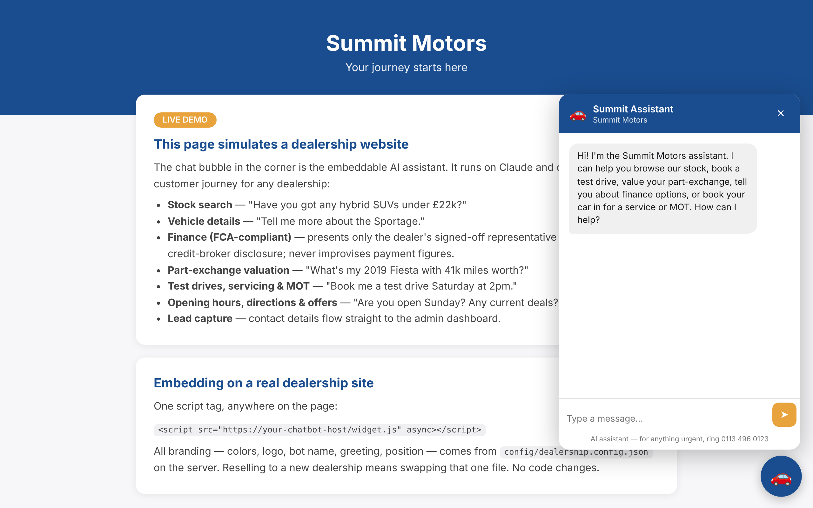

# Dealership Chatbot

A Claude-powered assistant for UK car dealerships. It searches stock, books test drives and services, values part-exchanges and captures leads, and it adds to any dealer's website with one script tag.



**Status: shelved.** I built this in July 2026 and deployed it on Railway, then stopped in August 2026 over legal concerns about cold-call selling and potential liability. It's a demo, not a product in use. Summit Motors and all its details, including the FCA number, are fictional.

## The interesting problem: finance

Quoting a monthly payment on a dealer's behalf is a financial promotion, and consumer car finance is regulated by the FCA. A chatbot that improvises a figure could land the dealer in trouble, so the design takes that option away:

- **There's no payment calculator.** The only finance figures available to Claude are the dealer's pre-approved representative example, returned word for word by a tool.
- **Finance is off unless a dealer signs it off.** If `approvedByDealer` isn't `true`, the finance tool is never given to the model, and customers are referred to the finance team.

This reduces the risk but doesn't guarantee compliance. It hasn't had a legal review.

## What it does

| Tool | Job |
|---|---|
| `search_inventory` | Searches stock by make, body style, fuel, price, mileage and more |
| `get_vehicle_details` | Gets the full specs for one car |
| `get_finance_information` | Returns the approved finance wording only |
| `estimate_part_exchange` | Gives a rough value range using a simple rule of thumb, not market data |
| `schedule_test_drive` | Creates a pending test drive appointment |
| `schedule_service` | Books services, MOTs and other workshop jobs |
| `capture_lead` | Saves contact details to the admin dashboard |
| `get_dealership_info` | Answers questions on hours, location, offers and fees |

## How it works

```
Dealer's website  -->  Node/Express server  -->  Claude API
  (widget.js)            /api/chat                (tool-use loop)
                         /api/admin/*
```

- **One codebase, many dealers:** branding and rules live in `config/dealership.config.json`, so a new dealer needs no code changes
- **Stack:** TypeScript, Express, Anthropic SDK, Docker, Railway
- **Default model:** `claude-sonnet-4-6`, changeable with `CLAUDE_MODEL`
- **Storage:** JSON files, with sample stock in `config/inventory.seed.json`

## Run it

You'll need Node 18+ and an Anthropic API key.

```bash
npm install
cp .env.example .env    # add ANTHROPIC_API_KEY and set ADMIN_TOKEN
npm run build
npm start
```

Then open `http://localhost:3000/` for the demo and `/admin.html` for the dashboard. Deployment steps are in [docs/DEPLOY.md](docs/DEPLOY.md), and setting up a new dealer is in [docs/WHITE_LABEL.md](docs/WHITE_LABEL.md).

## What it would need before real use

- Legal review of the finance wording, plus GDPR and consent handling
- Rate limiting on `/api/chat`, since each message costs money
- CORS limited to the dealer's domains (it currently allows any)
- A database and live stock feed in place of JSON files
- Real valuation data for part-exchanges
- Automated tests (there are none)

## How I built it

I built this with Claude Code. I'm an economics student rather than a software engineer, so I directed the build and tested the result rather than writing the code by hand.
